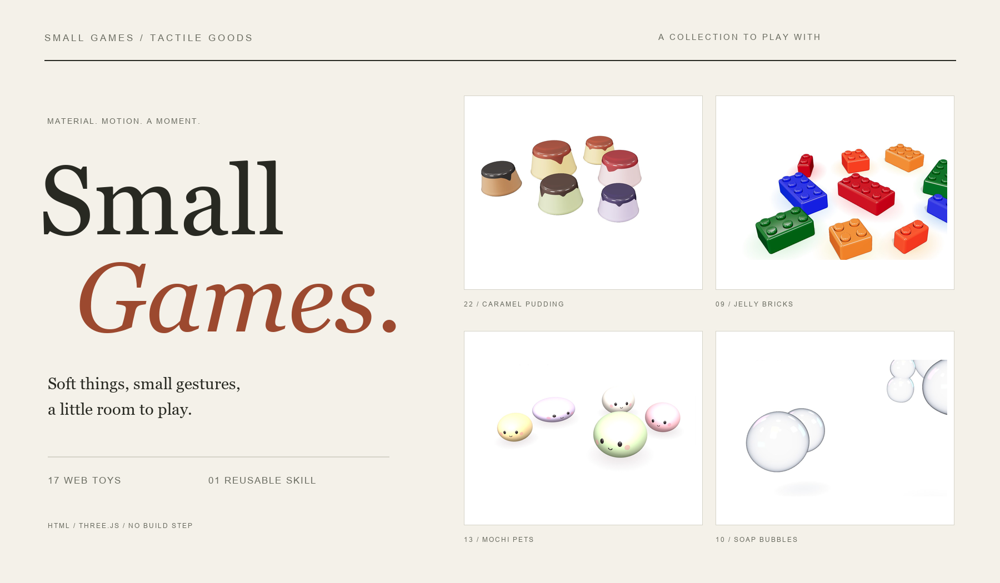
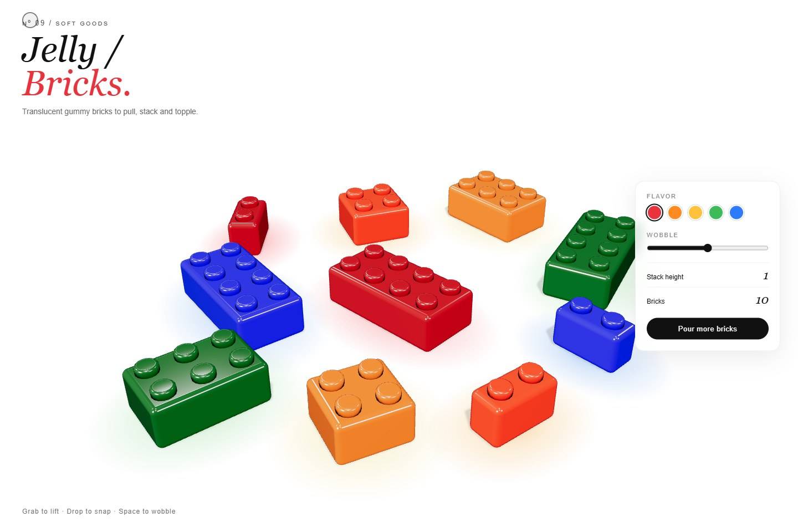
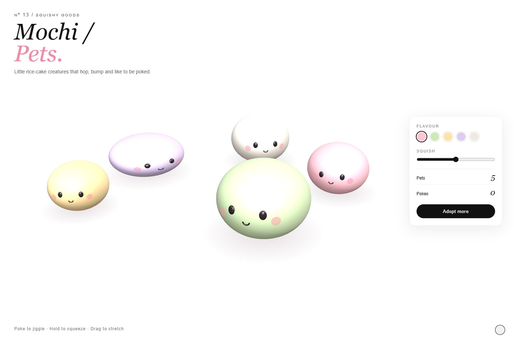
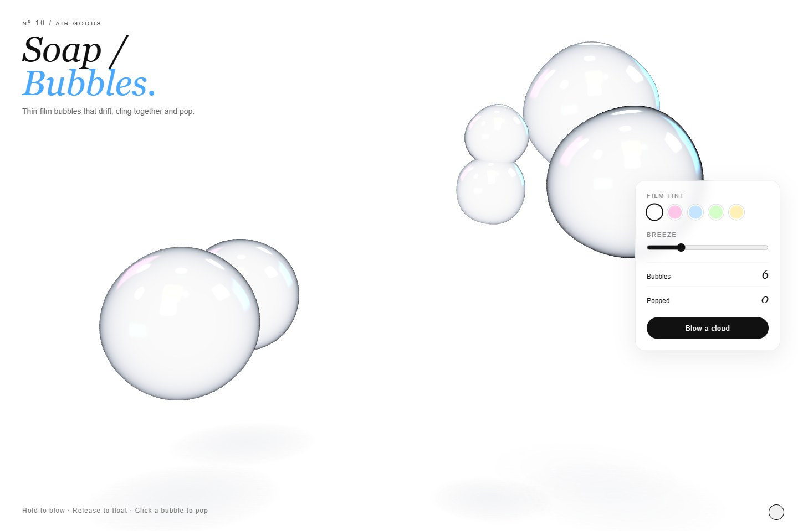
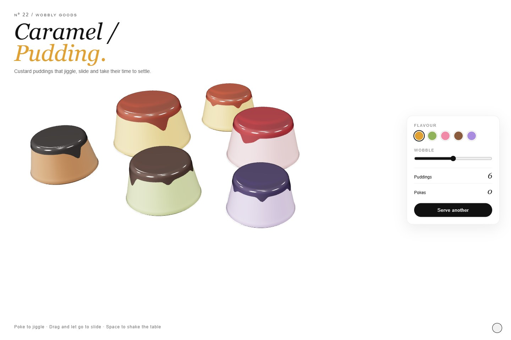
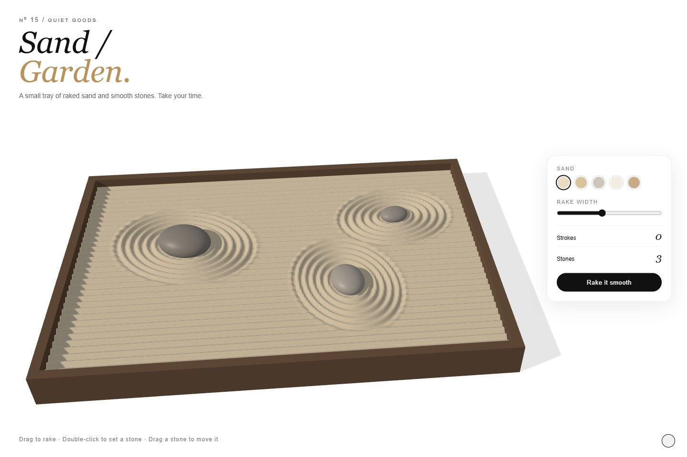
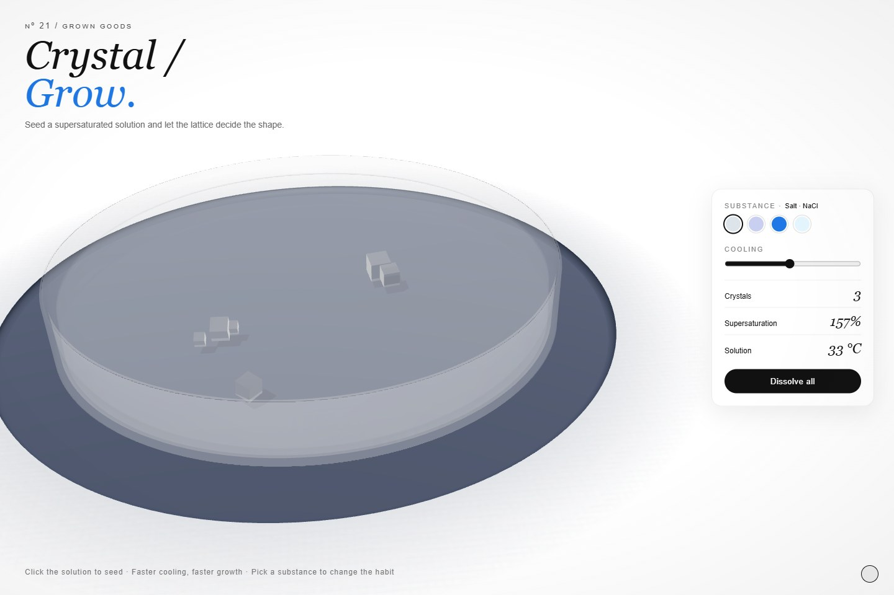

<div align="center">

<sub>SMALL GAMES · A COLLECTION OF TACTILE WEB TOYS</sub>

# Play with matter.

Soft things, small gestures, a little room to play.

**[Enter the collection ↗](https://jul11us.github.io/small-games/)** · [中文](README.zh-CN.md) · [Get the skill](#make-another)

<br>

[](https://jul11us.github.io/small-games/)

<br>

**17 web toys** &nbsp; / &nbsp; **1 reusable skill** &nbsp; / &nbsp; **No build step**

</div>

<br>

## Small objects. Satisfying responses.

A gummy brick stretches before it lifts. A pudding takes its time to settle. A sheet of bubble wrap waits for the next press.

Small Games is a collection of standalone HTML experiments in material, motion, and interaction. Open a scene and follow its gesture: pull, poke, rake, draw, stack, or simply let it move. The accompanying **tactile-toy** skill carries the same approach into your next creation.

## On the table

<table>
<tr>
<td width="33%"><a href="https://jul11us.github.io/small-games/jelly-bricks.html"></a><br><strong>Jelly Bricks</strong><br><sub>Lift. Stack. Topple.</sub></td>
<td width="33%"><a href="https://jul11us.github.io/small-games/mochi-pets.html"></a><br><strong>Mochi Pets</strong><br><sub>A poke, a squeeze, a little hop.</sub></td>
<td width="33%"><a href="https://jul11us.github.io/small-games/soap-bubbles.html"></a><br><strong>Soap Bubbles</strong><br><sub>Blow a cloud. Watch it drift.</sub></td>
</tr>
<tr>
<td><a href="https://jul11us.github.io/small-games/caramel-pudding.html"></a><br><strong>Caramel Pudding</strong><br><sub>The wobble after the touch.</sub></td>
<td><a href="https://jul11us.github.io/small-games/sand-garden.html"></a><br><strong>Sand Garden</strong><br><sub>Draw a line. Make room for a stone.</sub></td>
<td><a href="https://jul11us.github.io/small-games/crystal-grow.html"></a><br><strong>Crystal Grow</strong><br><sub>Plant a seed. Follow the shape.</sub></td>
</tr>
</table>

## The complete collection

Each title opens a playable page. Every toy also has its own [HTML source](https://github.com/Jul11us/small-games).

| Nº | Toy | A gesture to begin |
| :-- | :-- | :-- |
| 09 | [Jelly Bricks](https://jul11us.github.io/small-games/jelly-bricks.html) | Grab to lift; drop to snap; press Space to wobble. |
| 10 | [Soap Bubbles](https://jul11us.github.io/small-games/soap-bubbles.html) | Hold to blow; release to float; click to pop. |
| 11 | [Marble Run](https://jul11us.github.io/small-games/marble-run.html) | Drag track pieces; right-click or press R to rotate; scroll to raise. |
| 12 | [Clay Stamp](https://jul11us.github.io/small-games/clay-stamp.html) | Click to stamp; drag to draw; Shift-drag to smear. |
| 13 | [Mochi Pets](https://jul11us.github.io/small-games/mochi-pets.html) | Poke to jiggle; hold to squeeze; drag to stretch. |
| 14 | [Glass Chimes](https://jul11us.github.io/small-games/wind-chimes.html) | Click once to enable sound, then swipe through the glass tubes. |
| 15 | [Sand Garden](https://jul11us.github.io/small-games/sand-garden.html) | Drag to rake; double-click to set a stone. |
| 16 | [Gel Pens](https://jul11us.github.io/small-games/gel-pens.html) | Drag to draw; adjust Flow to let the ink run. |
| 17 | [Popcorn](https://jul11us.github.io/small-games/popcorn.html) | Hold to heat; release to cool; heat again to re-pop. |
| 18 | [Data Garden](https://jul11us.github.io/small-games/data-garden.html) | Enter numbers to grow flowers; hover to read their values. |
| 19 | [Molecule Kit](https://jul11us.github.io/small-games/molecule-kit.html) | Place atoms; drag them together to form bonds. |
| 20 | [pH Lab](https://jul11us.github.io/small-games/ph-lab.html) | Click to drip; use A / B to switch acid and base. |
| 21 | [Crystal Grow](https://jul11us.github.io/small-games/crystal-grow.html) | Click the solution to seed; adjust cooling and substance. |
| 22 | [Caramel Pudding](https://jul11us.github.io/small-games/caramel-pudding.html) | Poke to jiggle; drag to slide; press Space to shake the table. |
| 25 | [Bubble Wrap](https://jul11us.github.io/small-games/bubble-wrap.html) | Press to pop; drag to pop a row. |
| 26 | [Kinetic Sand](https://jul11us.github.io/small-games/kinetic-sand.html) | Drag to slice; press and hold to squish. |
| 27 | [Squishy Slime](https://jul11us.github.io/small-games/slime.html) | Grab and pull to stretch; click to poke. |

The original scene numbers are preserved. Sound-enabled toys may need a click before audio begins.

## A shared sensibility

- **Start with the material.** Translucent jelly, glossy caramel, thin glass, soft clay: the surface gives each scene its character.
- **Give the gesture a response.** Spring-driven deformation, inertia, and settling make an action continue after the pointer stops.
- **Leave space around the object.** A white stage, an italic title, a compact control panel, and a few words of guidance frame the collection.
- **Keep the file approachable.** Each toy lives in one HTML file, with its interface, scene, and interaction together.

## Run locally

Clone or download the repository, open a terminal in its folder, and start a static server:

```sh
python -m http.server 8000 --bind 127.0.0.1
```

Open **[localhost:8000](http://localhost:8000/)** for the collection, or go directly to a toy such as **[jelly-bricks.html](http://localhost:8000/jelly-bricks.html)**. There is no npm install or build command.

Use a modern browser with WebGL support. The toy pages fetch JavaScript modules from **unpkg.com**, so an internet connection is required: Three.js **0.160.0** for most scenes, **0.170.0** for Crystal Grow, and **cannon-es 0.20.0** where used. Pointer and keyboard controls are listed inside each scene.

## Make another

The **[tactile-toy skill](tactile-toy/SKILL.md)** is a reusable brief, implementation guide, and reference library for AI coding agents. It describes how to make another single-file toy in this visual language: choose a material, define the action and its response, build from the template, and inspect the result in a browser.

**Install it in either form:**

1. **Packaged:** [Download tactile-toy.skill](https://github.com/Jul11us/small-games/raw/refs/heads/main/tactile-toy.skill) and import it if your agent supports `.skill` packages.
2. **Folder:** Copy [`tactile-toy/`](tactile-toy/) into your agent's configured skills directory, for example `~/.codex/skills/tactile-toy/` or `~/.claude/skills/tactile-toy/`.

Then ask naturally:

> Use tactile-toy to make a water-balloon toy: glossy rubber, a heavy stretch when lifted, and a gentle wobble when dropped. Deliver one HTML file.

> 用 tactile-toy 做一个软糖小玩具：可以捏、拉、堆起来，松手后慢慢回弹，保持这个系列的白底版式。

The skill's instructions are primarily in Chinese; its example interfaces use English.

```text
tactile-toy/
├── SKILL.md                 # Workflow and design rules
├── assets/
│   └── template.html        # Shared layout and scene foundation
├── references/
│   ├── materials.md         # Material recipes
│   ├── feel.md              # Springs, deformation, and interaction
│   └── catalog.md           # Guide to the 14 bundled examples
└── examples/                # 14 complete HTML toys, Nº 09–22
```

The playable collection at the repository root contains **17 toys**. The skill bundles **14 examples** as a focused reference set.

<br>

---

<div align="center">
<sub>Made of HTML, Three.js, and small gestures.</sub><br>
<a href="https://jul11us.github.io/small-games/">Take a moment to play ↗</a>
</div>
